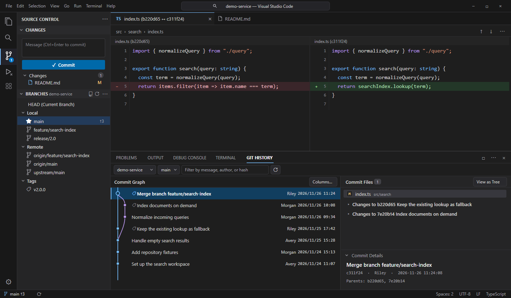

# Git Branch

在 VS Code 的源代码管理侧栏管理分支，在底部 **Git 历史**面板查看提交图和文件差异。暂存、提交和冲突解决继续使用 VS Code 自带的 **Changes** 视图。

## 主要功能

- **分支管理**：创建、检出、重命名和删除分支；支持快进更新、拉取、推送、合并、变基和新建工作树。本地与远程分支平铺显示，标签可按需开启。
- **提交历史**：按分支查看提交图，按提交消息、作者或哈希筛选。默认显示作者和时间，短哈希可在「显示列…」开启。合并提交先显示冲突相关变动，下方可展开与各个父提交的完整差异。
- **差异查看**：比较两个分支，或将分支与当前工作树比较，无需切换分支。文件区支持列表和目录树，点击文件即可打开 VS Code 原生 Diff。
- **提交与文件操作**：右键提交可复制哈希、Cherry-Pick、Revert，或从该提交创建分支和标签；右键文件可打开工作区文件、查看仓库版本，或将选中的改动应用到工作树，不暂存、不提交。

## 快速上手

1. 打开一个受信任的 Git 仓库，确认 VS Code 的内置 Git 扩展已启用。在 **源代码管理 → 分支（Branches）** 中查看本地和远程分支；右键分支可创建分支、检出、更新或比较。打开多个仓库时，点击 **Branches 标题栏的仓库图标**或底栏仓库选择器切换。
2. 从底栏打开 **Git 历史（Git History）**，或运行命令 **Git Branch: 显示 Git 历史**（**Git Branch: Show Git History**）。默认查看当前分支，范围菜单可按名称或短哈希查找本地分支、远程分支，也可选「全部分支」。在 **Branches → … → 显示标签** 开启标签范围。双击分支，或右键选择 **查看历史（View History）**，也可直接查看该分支而不检出。提交图右上角的 **显示列…（Columns…）** 用于选择显示哪些列。
3. 在底栏选择提交，再点击右侧文件查看差异。按住 `Ctrl`（macOS 上为 `Cmd`）单击可增减选中的提交，按住 `Shift` 单击可选择一段。多选时按文件显示合成差异；仅被未选提交修改的文件不会列出。

**注意：** 在远程分支上选择「删除」并确认后，删除的是服务器上的实际分支，不只是本地记录。

## 安装与语言

- 需要桌面版 VS Code 1.85 或更高版本、Git 和启用的内置 Git 扩展。使用本地 `.vsix` 时，从扩展视图的 `…` 菜单选择 **Install from VSIX…** 即可安装。
- 界面跟随 VS Code 的显示语言，支持简体中文、繁體中文和英文，其他语言回退到英文。
